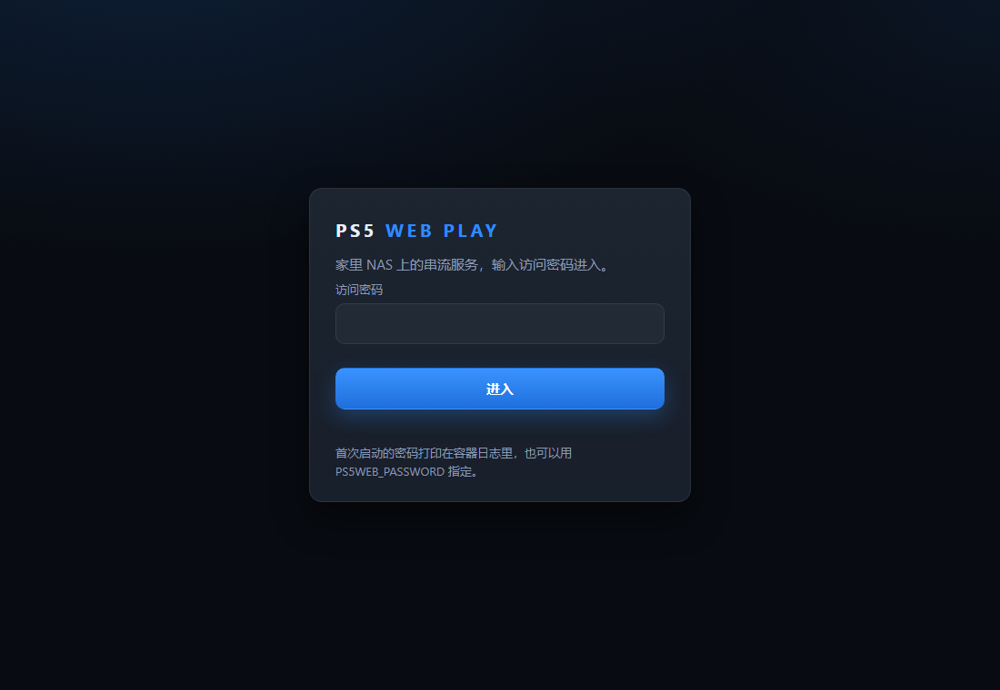
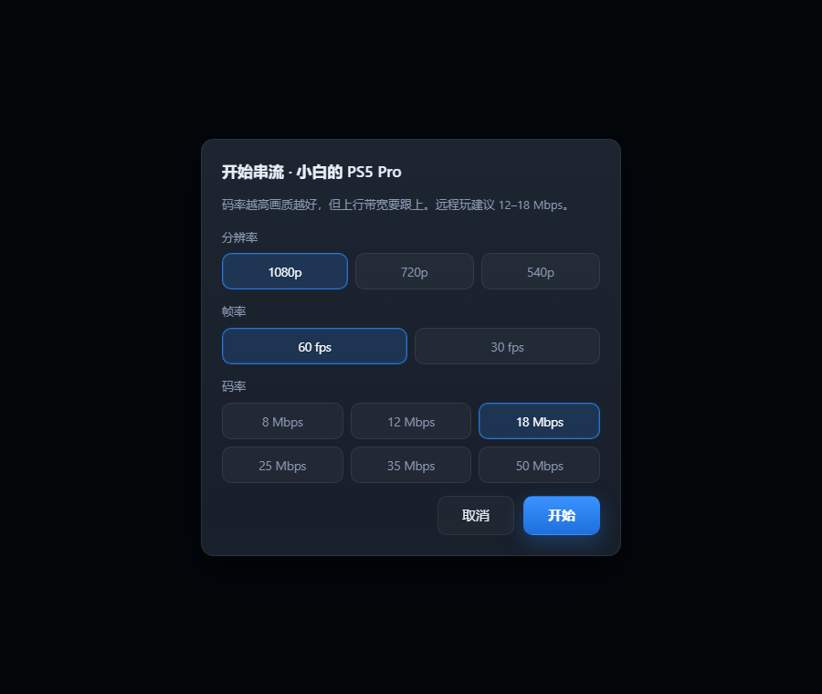

# PS5 Web Play

把家里的 PS5 串流到**任意设备的浏览器**：NAS 上跑一个容器，Web 端口映射出去，手机、平板、公司电脑、电视盒子打开网页就能玩，插手柄或者用屏幕按键。

底层不是重写的协议栈，而是把 [chiaki-ng](https://github.com/chiaki-ng/chiaki-ng) 的 `libchiaki` 直接编进一个桥接进程，配对、握手、SRTP、FEC 全部复用上游实现，上面再套一层 Web 服务。

> 源码：[github.com/xiaobai9978/ps5web](https://github.com/xiaobai9978/ps5web) · 现成镜像：`docker pull xiaobai9978/ps5web:1.1.1`（[Docker Hub](https://hub.docker.com/r/xiaobai9978/ps5web)）
> 镜像里**不含任何配对凭据**，凭据只在你自己挂载的 `./data` 里。

```
┌──────────────┐   WebSocket(TCP 8080)   ┌────────────────────┐   UDP 9295/9296/9302
│   浏览器      │ ◀─────────────────────▶ │  Node 服务端        │ ◀──────────────────▶  PS5
│ WebCodecs 解码│   视频/音频/手柄状态      │  ├ 静态页 + 登录     │      局域网
│ 手柄/触屏输入  │                         │  └ ps5web-bridge   │
└──────────────┘                         │     (链接 libchiaki) │
                                          └────────────────────┘
```

## 界面

| 登录 | 开始串流（画质） |
| --- | --- |
|  |  |

## 特性

- 一个 TCP 端口搞定：视频、音频、输入全走同一条 WebSocket，frp / nginx 反代友好（不需要 UDP 打洞、不需要 TURN）
- 视频用 **WebCodecs** 硬解，`VideoFrame` 直接画 canvas，比 MSE 少几百毫秒缓冲
- 音频是 PS5 原始 Opus 流，浏览器 `AudioDecoder` 解码 + 环形缓冲吸收抖动
- 输入支持：物理手柄（Gamepad API，含震动）、键盘鼠标、手机屏幕按键（双摇杆 + 十字键 + 面板键 + 肩键 + 触摸板）
- 摇杆是浮动式的：在下半屏任意位置按下去，摇杆就以手指为中心，像手游那样推；松手弹回原位
- 下半屏左右两侧都是摇杆区，右边那块直接就是视角控制（等于右摇杆）
- 屏幕按键可调：播放页 ⚙ 里能改大小、离边距离（贴边/适中/靠里/很靠里）、显隐十字键、震动，设置存在浏览器本地
- 触摸板只认屏幕中间 32%×44% 的区域（避开十字键和面板键）：**滑动＝在触摸板上滑，轻点＝按下触摸板**；顶部空白区域用于显隐顶栏
- 刷新不丢会话：页面重开后顶栏会出现「继续接入」，直接接回 NAS 上还在跑的串流，不用重新唤醒主机
- 切后台不黑屏：从控制中心/锁屏回来后自动重建解码链路，另有 3 秒无新帧的看门狗兜底
- 局域网自动发现主机、一键配对、待机唤醒
- 单密码登录 + HMAC 会话，密码默认随机生成
- 画质可调：720p/1080p、30/60fps、8–50 Mbps

## 先看清楚这几条限制

| 限制 | 说明 |
| --- | --- |
| **必须 HTTPS（或 localhost）** | 浏览器只在安全上下文里开放 WebCodecs 和 Gamepad。用 `http://内网IP:8080` 打开会**黑屏 + 没声音 + 认不到手柄**，页面顶部会顶一条橙色横幅提醒你。见下面「TLS」一节。 |
| **同一时间只能一个人玩** | PS5 本身只接受一个 Remote Play 会话。多人看同一路流可以，但同时开两个会话不行。 |
| **NAS 必须和 PS5 同局域网** | 这是「家里的 PS5」方案，不是 PSN 云串流。NAS 到 PS5 是内网 UDP。 |
| **公网只暴露一个 TCP 端口** | 上行带宽决定画质：1080p60 大约需要 18–25 Mbps 稳定上行。 |
| **浏览器要支持 WebCodecs** | Chrome/Edge 94+、Safari 16.4+、Firefox 130+。老浏览器只能看到提示。 |
| **iPhone 没有网页全屏** | iOS 上的浏览器（含 iOS 版 Firefox/Chrome，全是 WebKit）不提供 `requestFullscreen`。点右上角 ⛶ 会进入「沉浸模式」；要真正没有地址栏，用「分享 → 添加到主屏幕」，从图标启动（已配好 PWA manifest）。 |
| **iOS 双击缩放已禁用** | 播放页和首页都拦掉了双击放大（iOS 忽略 `user-scalable=no`）；已经放大时不再拦截，双击/双指仍可缩小。 |
| **iPhone 不能震动** | iOS 的 WebKit 从没实现 Vibration API，任何浏览器都调不动 iPhone 马达。Android 上会跟着手柄震动；iPhone 上退化成屏幕边缘柔光（可在 ⚙ 里关）。 |
| **延迟** | 局域网额外 20–50ms；跨公网主要看链路，实测常见 60–120ms。 |

## TLS：三个办法，任选一个

**① 反代（生产推荐）**：nginx / caddy 在前面终止 TLS，见下面「公网访问」。

**② 让服务自己上 HTTPS**（局域网自测最快）：给两个环境变量指证书就行。

```bash
# 生成一张自签证书（SAN 里带上 NAS 的 IP）
openssl req -x509 -newkey rsa:2048 -nodes -days 3650 \
  -keyout tls/key.pem -out tls/cert.pem \
  -subj "/CN=ps5web" \
  -addext "subjectAltName=IP:192.168.50.10,IP:127.0.0.1,DNS:localhost"
```

```yaml
environment:
  PS5WEB_PORT: "8443"
  PS5WEB_TLS_CERT: /data/tls/cert.pem
  PS5WEB_TLS_KEY: /data/tls/key.pem
```

浏览器第一次会报「证书不受信任」，点「高级 → 继续前往」即可（点过一次之后 WebSocket 也一起放行）。

**③ 临时绕开**：Chrome 打开 `chrome://flags/#unsafely-treat-insecure-origin-as-secure`，把 `http://192.168.50.10:8080` 加进去，重启浏览器。只适合调试。

## 环境要求

- NAS 能跑 Docker（x86_64 / arm64 都行），建议 2 核以上
- NAS 与 PS5 在同一网段，能互通 UDP
- PS5：`设置 → 系统 → 远程游玩 → 启用远程游玩`
- 浏览器：Chrome / Edge / Safari 16.4+ / Firefox 130+

## 快速开始

已经推到 Docker Hub 上了，`docker pull` 就能用，不用自己编译：

```bash
# 1. 拉镜像（238MB，分层算下来实际下载不到 100MB）
docker pull xiaobai9978/ps5web:1.1.1

# 2. 起服务（compose 里已经写好 image，另外 network_mode: host 是必须的）
cd ps5web
docker compose up -d

# 3. 看初始密码
docker compose logs -f ps5web
#   ==============================================
#   初始登录密码: k7m2pqx9rt
#   ==============================================

# 4. 浏览器打开 http://NAS的IP:8080
```

不想用 compose 也行：

```bash
docker run -d --name ps5web --network host --restart unless-stopped \
  -e PS5WEB_PASSWORD=你的密码 \
  -v /volume1/docker/ps5web:/data \
  xiaobai9978/ps5web:1.1.1
```

### 想自己构建

改了代码、或者不信任我推的镜像：

```bash
docker compose build          # 第一次要编译 chiaki-ng，5–10 分钟
docker compose up -d
```

国内构建一定要走镜像源，否则 `deb.debian.org` 能卡十分钟：

```bash
docker build \
  --build-arg APT_MIRROR=http://mirrors.ustc.edu.cn/debian \
  --build-arg APT_SECURITY_MIRROR=http://mirrors.ustc.edu.cn/debian-security \
  -t ps5web:dev .
```

> 镜像里只有：Debian bookworm 运行时库 + 编译好的 `ps5web-bridge` + Node 20/22 的服务端和前端。
> 源码、编译器、chiaki-ng 的 .git 都在构建阶段丢掉，不进最终镜像。

### 多架构镜像（amd64 + arm64）

仓库里带了 `.github/workflows/docker.yml`：推一个 `v*` tag 或者手动触发，
GitHub Actions 会用 buildx 构建 `linux/amd64` + `linux/arm64` 推到 Docker Hub。

用之前先在仓库 `Settings → Secrets and variables → Actions` 里加两个 secret：

| Secret | 值 |
| --- | --- |
| `DOCKERHUB_USERNAME` | 你的 Docker Hub 用户名 |
| `DOCKERHUB_TOKEN` | Docker Hub 的 access token（不要用登录密码） |

ARM 的群晖/树莓派也能跑，但如实说一句：**arm64 只验证到能构建**，没在真机上串流过。

登录后：

1. 点「扫描局域网」，找到你的 PS5（扫不到就手动填 IP）
2. 点「添加并配对」，按提示拿 PIN 和 PSN Account-ID
3. 回到列表点「开始串流」，选画质，开玩

### 配对要准备两样东西

**① PS5 上的 PIN**：`设置 → 系统 → 远程游玩 → 关联设备`，屏幕会显示 8 位数字。

**② PSN Account-ID**：打开 <https://psn.flipscreen.games>，登录 PSN，复制页面上的 `Account-ID`（base64 的一串，解出来正好 8 字节）。

> 配对只需要一次。之后 `registKey` / `rpKey` 存在 NAS 的 `data/hosts.json`（权限 0600），不会下发给浏览器。

### 已经有配对凭据？跳过配对

如果你之前用 chiaki-ng（Windows/Linux/掌机版都行）连过这台 PS5，就不用再配对一次——直接把凭据写进 `data/hosts.json`：

```json
{
  "hosts": [
    {
      "id": "a1b2c3d4",
      "name": "客厅 PS5",
      "address": "192.168.50.116",
      "ps5": true,
      "registKey": "66333934323200000000000000000000",
      "rpKey": "1f35deac3d550fe82bff69706c0553ff",
      "mac": "2840dd1ad524",
      "addedAt": 0,
      "lastPairedAt": 0
    }
  ]
}
```

`registKey` / `rpKey` 都是 32 个十六进制字符（16 字节）。从哪里找：

- **Windows**：注册表 `HKCU\Software\Chiaki\Chiaki\registered_hosts\<n>`
  - `rp_regist_key` 是 REG_BINARY，里面是 UTF-16 的 `@ByteArray(f39422\0\0…)`，取括号里那段 ASCII 再补 `00` 到 16 字节
  - `rp_key` 是 REG_SZ，格式 `@ByteArray(<16 个原始字节>)`，把那 16 个字节转成 hex
  - `server_mac` 同理（6 字节）
- **Linux / 掌机**：`~/.config/chiaki-ng/chiaki-ng.conf` 里的 `rp_regist_key` / `rp_key`（Base64）

> 这个包里的 `data/hosts.json` 已经填好了你那台「小白的 PS5 Pro」（192.168.50.116）。
> 如果你想从零开始，删掉 `data/` 目录即可。

### 待机 / 唤醒

- **唤醒**：列表里点「唤醒」，给待机的主机发一个带 regist key 的 WAKEUP 包。实测 PS5 Pro 上有效（发完 10–30 秒 9295 端口起来），前提是主机的电源设置里勾了「待机时保持网络连接」。
  直接点「开始串流」也行——服务端发现 9295 不通会自动发唤醒包并等它起来（实测从冷待机到出画面 43 秒）。
- **待机**：串流中按右上角 🌙，让主机回到休息模式，然后自己断开（PS5 会回一句 `Server shutting down`）。注意它要 30 秒左右才真正断电——PS5 得先把正在跑的游戏/应用关掉，别以为没生效就连点。

## 端口与网络

| 用途 | 协议/端口 | 方向 |
| --- | --- | --- |
| 网页 / WebSocket | TCP 8080（可改） | 公网 → NAS |
| 发现（广播） | UDP 9302、987 | NAS → 局域网广播 |
| 会话 / 控制 / 码流 | UDP 9295、9296（及 PS5 回流的随机端口） | NAS ↔ PS5 |

所以 `docker-compose.yml` 里用了 `network_mode: host`：广播发现和回流的 UDP 端口都不用操心。

如果你的环境只能用桥接网络，就删掉 `network_mode` 换成 `ports: ["8080:8080"]`，代价是自动发现失效，只能手动填 IP。

## 公网访问

### 方案 A：frp（最省事）

```ini
# frpc.ini
[ps5web]
type = tcp
local_ip = 192.168.1.10     # NAS 的局域网 IP
local_port = 8080
remote_port = 17001
```

然后访问 `http://你的服务器:17001`。**记得前面套 TLS**，否则手柄用不了。

### 方案 B：nginx 反代 + Let's Encrypt

```nginx
server {
    listen 443 ssl http2;
    server_name ps5.example.com;

    ssl_certificate     /etc/letsencrypt/live/ps5.example.com/fullchain.pem;
    ssl_certificate_key /etc/letsencrypt/live/ps5.example.com/privkey.pem;

    location / {
        proxy_pass http://127.0.0.1:8080;
        proxy_http_version 1.1;

        # WebSocket
        proxy_set_header Upgrade $http_upgrade;
        proxy_set_header Connection "upgrade";

        proxy_set_header Host $host;
        proxy_set_header X-Forwarded-For $proxy_add_x_forwarded_for;
        proxy_set_header X-Forwarded-Proto $scheme;

        # 串流是长连接，视频流不能缓冲
        proxy_buffering off;
        proxy_read_timeout 3600s;
        proxy_send_timeout 3600s;
    }
}
```

Caddy 更简单：

```
ps5.example.com {
    reverse_proxy 192.168.1.10:8080
}
```

## 实测数据（PS5 Pro · 局域网 · 1080p60 档位）

在 PVE 的 Debian 容器里跑桥接层，直接连主机抓了 12 秒：

| 指标 | 数值 |
| --- | --- |
| 视频 | 1920×1080，H.264 **Main@5.0**（`avc1.4D4032`），NAL 里 SPS/PPS/IDR/P 齐全 |
| 帧率 | 空闲桌面约 44 fps（PS5 按画面变化出帧，游戏里才接近 60） |
| 码率 | 空闲桌面 0.8–1.0 Mbps（码率是上限，不是恒定值） |
| 音频 | Opus 48 kHz 立体声，每包 80 字节 ≈ 75 包/秒 |
| 端到端 | 登录 → 唤醒 → 开会话 → WebSocket 收流：10 秒 270 帧视频 / 456 个音频包，WS 握手 accept 校验通过 |
| 唤醒 | 待机 → 发 WAKEUP → 9295 端口起来，约 10 秒 |
| 待机 | 会话中发 sleep → 主机回 `Server shutting down` → 约 35 秒后 9295 关闭 |

延迟没有在这个容器里量（没有显示端）；按 chiaki 的经验，局域网 720p60 大约 40–60 ms，公网看链路。

## 配置项

全部通过环境变量，`docker-compose.yml` 里改。

| 变量 | 默认值 | 说明 |
| --- | --- | --- |
| `PS5WEB_PASSWORD` | 首次随机生成 | 登录密码。留空则用 `data/config.json` 里生成的那个 |
| `PS5WEB_PORT` | `8080` | 监听端口 |
| `PS5WEB_DATA` | `/data` | 数据目录（主机凭据、配置） |
| `PS5WEB_RESOLUTION` | `1080p` | 默认分辨率：`1080p` / `720p` / `540p` |
| `PS5WEB_FPS` | `60` | 默认帧率：30 / 60 |
| `PS5WEB_BITRATE` | `18000` | 默认码率（kbps） |
| `PS5WEB_CODEC` | `h264` | `h264`（通用）或 `h265`（实验性，需浏览器支持 HEVC） |
| `PS5WEB_LOG_LEVEL` | `info` | `debug` 会打印 chiaki 的详细日志 |
| `PS5WEB_TRUST_PROXY` | `1` | 在反代后面时读 `X-Forwarded-*`，用来判断 HTTPS 和真实 IP |
| `PS5WEB_TLS_CERT` | 空 | 证书路径。和 `PS5WEB_TLS_KEY` 一起设置时，服务直接用 HTTPS |
| `PS5WEB_TLS_KEY` | 空 | 私钥路径 |
| `PS5WEB_BRIDGE` | `/usr/local/bin/ps5web-bridge` | 桥接进程路径（开发时可指向 mock） |

默认值只是「开始串流」对话框里的初值，每次开始前都能改。

## 从源码编译（不用 Docker）

```bash
# 依赖（Debian/Ubuntu）
sudo apt install -y build-essential cmake pkg-config git python3 python3-protobuf \
    protobuf-compiler libssl-dev libjson-c-dev libevent-dev libminiupnpc-dev zlib1g-dev

# 拉 chiaki-ng（要带子模块）
git clone --recurse-submodules --depth 1 --branch v1.10.1 \
    https://github.com/chiaki-ng/chiaki-ng.git chiaki-ng

# 编桥接
cmake -S bridge -B build -DCHIAKI_DIR=$PWD/chiaki-ng -DCMAKE_BUILD_TYPE=Release
cmake --build build -j$(nproc)

# 起服务
PS5WEB_BRIDGE=$PWD/build/ps5web-bridge \
PS5WEB_WEB_DIR=$PWD/web \
PS5WEB_DATA=$PWD/data \
node server/src/index.js
```

### 不接 PS5 也能调前端

仓库带了一个假桥接进程，按协议回事件，用来调界面：

```bash
PS5WEB_BRIDGE=./server/src/mock-bridge.js \
PS5WEB_DATA=./data PS5WEB_PASSWORD=test1234 \
node server/src/index.js
```

它会假装发现两台主机、配对成功、进入串流状态（没有真实画面）。

## 目录结构

```
ps5web/
├── bridge/                  C 桥接层，链接 libchiaki
│   ├── CMakeLists.txt
│   └── src/
│       ├── main.c           发现 / 配对 / 会话 / 视频音频回调 / 输入注入
│       ├── proto.c          与 Node 之间的分帧协议
│       └── proto.h
├── server/                  Node 服务端（零 npm 依赖）
│   └── src/
│       ├── index.js         HTTP + API + WebSocket
│       ├── engine.js        会话状态机、码流分发
│       ├── bridge.js        子进程管理
│       ├── ws.js            手写的 WebSocket 服务端
│       ├── store.js         主机凭据持久化
│       └── mock-bridge.js   开发用假桥接
├── web/                     前端（原生 ES Module，无打包）
│   ├── index.html
│   ├── css/app.css
│   └── js/
│       ├── video.js         WebCodecs 解码 + canvas 渲染
│       ├── audio.js         Opus 解码 + Worklet 播放
│       ├── audio-worklet.js 环形缓冲
│       ├── input.js         手柄/键盘/触屏输入合成
│       ├── net.js           WebSocket 客户端
│       └── app.js           UI
├── Dockerfile
├── docker-compose.yml
└── chiaki-ng/               可选：放本地 chiaki-ng 源码避免构建时联网
```

## 协议速记

桥接进程和 Node 之间：`[u8 类型][u32 大端长度][负载]`

| 类型 | 方向 | 负载 |
| --- | --- | --- |
| 1 | 双向 | JSON 命令 / 事件 |
| 2 | Node → 桥接 | 28 字节手柄状态 |
| 3 | 桥接 → Node | 16 字节头（时间戳、关键帧标志、丢帧数）+ Annex-B 码流 |
| 4 | 桥接 → Node | 8 字节时间戳 + Opus 包 |

Node 与浏览器之间：WebSocket 文本帧走 JSON 事件，二进制帧首字节是 `0x10`（视频）/ `0x11`（音频）/ `0x01`（输入，客户端上行）。

## 常见问题

**扫描不到主机**
容器不是 host 网络，或 NAS 有多个网段。先手动填 IP 试；能连上就说明只是广播没通。

**配对失败 / 0x80108b09**
PIN 过期（PS5 那个界面 2 分钟就失效），重新点一次「关联设备」；或者 Account-ID 不对，确认用的是 base64 那串。

**提示「已在其他设备上使用」**
PS5 上还有别的 Remote Play 会话（PS Remote Play App、chiaki、另一台浏览器）。先在那边退出。

**连上了但黑屏**
一般是只有音频没有视频。看容器日志里有没有 `Video Profiles:`；浏览器控制台会有 `[video]` 开头的日志。多半是浏览器不支持该 H.264 profile，换 Chrome 试试。

**没有声音**
点一下画面。浏览器自动播放策略要求用户手势才能开音频，右下角有「点击启用声音」按钮，点一下就出声。

**画面卡 / 延迟越来越大**
降码率到 12 Mbps、分辨率到 720p。公网上行不稳的时候，1080p60 很难稳住。

**H.265 能不能开**
桥接层支持（`PS5WEB_CODEC=h265`），但浏览器端 HEVC 解码要系统支持：Safari / Edge 比较靠谱，Chrome 看平台。不建议当默认值。

## 安全提示

- 这个服务等于把 PS5 的控制器交给你给的密码，**别用弱密码**，别裸奔在公网 http 上。
- 建议只在需要时开端口，或者套一层 VPN / Tailscale。
- `data/hosts.json` 里有能直接连主机的凭据，注意备份和权限（容器里是 0600）。

## 许可

本项目链接 chiaki-ng 的 `libchiaki`，因此整体按 **AGPL-3.0-only** 发布。chiaki-ng 本身是 AGPL-3.0（含 OpenSSL 例外条款），详见上游仓库的 `COPYING` 与 `LICENSES/`。

自己改着玩没问题；如果要对外提供服务，记得履行 AGPL 的源码提供义务。
